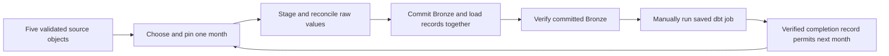

# BDE-AT3

Airbnb and Census ELT pipeline for Big Data Engineering Assignment 3.

The current implementation prepares the Bronze layer in PostgreSQL database `BDEAT3`. The combined Airflow DAG loads May 2020 first, then the remaining eleven months in chronological order. Each later month requires the preceding month's verified Bronze load and recorded successful dbt deployment job.

## Files

| File | Purpose |
|---|---|
| `part_1.sql` | One-time guarded schema and raw-table setup, run in DBeaver |
| `dags/airbnb_census_monthly_rebuild.py` | Unscheduled monthly load and exact source reconciliation |
| `source_manifest.json` | SHA-256 hashes and row counts of the sixteen supplied CSVs |
| `tests/test_part1.py` | Local PostgreSQL integration and failure tests |
| `docs/part_1_setup.md` | Connection, input, execution and recovery instructions |
| `docs/validation.md` | Test scope, results and remaining cloud checks |

The dbt project and saved deployment job are the next implementation unit. The completion ledger remains empty in the cloud until that job is implemented and verified. Part 4 analysis is deferred.

## Design

All source fields remain text in Bronze. Filename months establish observation dates; the supplied scrape dates remain unchanged. Silver will perform cleaning and typing. Host and Property will use timestamp snapshots. Static geographic and Census references do not require SCD history.

The database and source prefix are separate from earlier work. Database identity, SSL, table structure, source hashes, object generations and chronological history are checked before loading. Identical retries verify existing rows without changing their load timestamps. A failed write rolls back all raw-table and load-ledger writes in that transaction.
