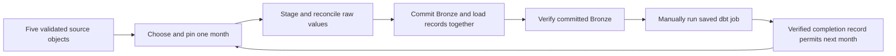

# BDE-AT3

Airbnb and Census ELT pipeline for Big Data Engineering Assignment 3.

Parts 1 and 2 are complete in PostgreSQL database `BDEAT3`. The May 2020 Airflow load succeeded on 21 October 2026; independent DBeaver checks confirmed all five source counts and contents. On 22 October, the isolated development build and saved production job both passed all 47 data tests. Cloud SQL contains 37,562 May facts with correct historical dimension matches; all 9,002 independently calculated May datamart values matched. Part 3 is prepared but its cloud loads have not started. Part 4 is deferred.

## Files

| File | Purpose |
|---|---|
| `part_1.sql` | Guarded setup and separately labelled post-May verification SQL, run in DBeaver |
| `dags/airbnb_census_monthly_rebuild.py` | Unscheduled monthly load and exact source reconciliation |
| `source_manifest.json` | SHA-256 hashes and row counts of the sixteen supplied CSVs |
| `tests/test_part1.py` | Local PostgreSQL integration and failure tests |
| `dbt_project.yml`, `models/`, `snapshots/`, `macros/` | Silver, timestamp snapshots, Gold, datamart views and monthly validation controls |
| `tests/test_part2.py`, `tests/test_full_year.py` | Local dbt failure/retry tests and twelve-month rehearsal |
| `tests/independent_metrics.py` | Independent calculations from source CSVs for all datamart metrics |
| `verification.sql` | Read-only post-job checks for DBeaver |
| `docs/part_1_setup.md` | Connection, input, execution and recovery instructions |
| `docs/part_2_setup.md` | Development/production targets and the single-command monthly job |
| `docs/part_3_runbook.md` | Remaining monthly sequence, counts and recovery checklist |
| `docs/brief_coverage.md` | Mapping between requirements and project files |
| `docs/validation.md` | Local test scope, actual cloud results and remaining work |

The saved manual deployment job is `BDEAT3 monthly build` in `BDEAT3 Production`. Its single May command is:

```sh
dbt build --threads 1 --fail-fast --vars '{"observation_month":"2020-05-01"}'
```

The May production run [`70506184016163`](https://lk965.us1.dbt.com/deploy/70506183170770/projects/70506183174422/runs/70506184016163) passed on reviewed implementation commit `859be2d9178bf3bac904942fb9814ef45cf9aeb9`. The cloud completion ledger records its real job/run IDs and matching source manifest. Each later Airflow month requires the preceding month's verified Bronze load and recorded successful dbt deployment job. After each monthly load, change the job's month variable, manually run the job and wait for Success before the next load.

## Design



All source fields remain text in Bronze. Filename months establish observation dates; the supplied scrape dates remain unchanged. Silver performs cleaning and typing. Host and Property use timestamp snapshots. Static geographic and Census references do not require SCD history. The four Gold dimensions are Host, Property, LGA and Month. The fact has one row per observed listing-month; the three datamart views join the dimension versions valid for that month.

The database and source prefix are separate from earlier work. Database identity, SSL, table structure, source hashes, object generations and chronological history are checked before loading. Identical retries verify existing rows without changing their load timestamps. A failed write rolls back all raw-table and load-ledger writes in that transaction.
